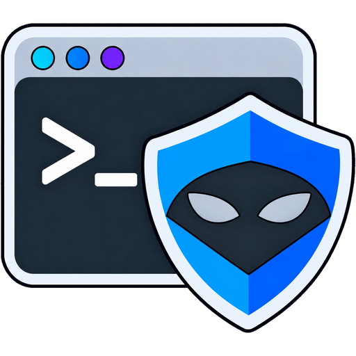
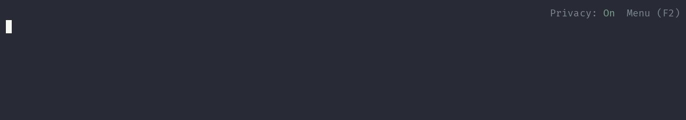

<p align="center">
  
</p>

# Incognito Terminal

[](https://github.com/Secragon/incognito-terminal/actions/workflows/ci.yml)
[](LICENSE)

Keep passwords, tokens, and other sensitive command-line values out of sight
while you work, share your screen, record a demonstration, or collaborate in a
public space.

Incognito Terminal conceals sensitive values as you type or paste them. Your
command still runs normally with its original value, and it runs only once. You
choose what should be hidden, how hidden text should look, and whether command
history should be kept.

The settings are available from a simple **F2** menu inside the session. No
shell customization is required, and your saved choices are restored the next
time you start Incognito Terminal.

<p align="center">
  
</p>

## What you can do

- Hide values recognized by your own configurable triggers.
- Mask the next value instantly with a keyboard shortcut.
- Conceal every command you type with **Crazy** privacy mode.
- Display hidden text as asterisks, password-like characters, or smiley emojis.
- Temporarily reveal concealed text while holding a shortcut.
- Keep normal shell history, keep it only for the current session, or disable it.
- Add command exceptions to avoid masking options that do not contain secrets.
- Use your existing Bash or Zsh setup and continue editing commands normally.

## Install

### Debian package

This is the easiest option for Kali Linux, Debian, Ubuntu, and related systems.
Download the package for your architecture from the
[latest release](https://github.com/Secragon/incognito-terminal/releases/latest).

- Choose `amd64` for most Intel and AMD computers.
- Choose `arm64` for 64-bit ARM systems, including ARM Linux virtual machines.

Install the downloaded file:

```sh
sudo apt install ./incognito-terminal_1.2.4-1_amd64.deb
```

Replace `amd64` with `arm64` when appropriate. The package adds **Incognito
Terminal** and **Incognito Terminal (Root)** to GNOME, KDE Plasma, and XFCE
application menus. It also installs the `incognito-terminal` command.

You can verify a download with the `SHA256SUMS` file included in every release:

```sh
package=incognito-terminal_1.2.4-1_amd64.deb
grep "  ./${package}$" SHA256SUMS | sha256sum --check
```

### Build from source

Install the build requirements:

```sh
sudo apt update
sudo apt install build-essential perl
```

Clone, build, and install:

```sh
git clone https://github.com/Secragon/incognito-terminal.git
cd incognito-terminal
make -j
sudo make install
```

The build uses the C sources and dependencies included in the repository. It
does not download code during compilation.

## Start a session

Open **Incognito Terminal** from your application menu, or run:

```sh
incognito-terminal
```

It starts your preferred shell. You can also choose Bash or Zsh explicitly:

```sh
incognito-terminal -- bash
incognito-terminal -- zsh
```

To try it without loading your personal shell startup files:

```sh
incognito-terminal --clean -- zsh
```

The top-right indicator shows the current privacy state. Press **F2** whenever
you want to change a setting. Type `exit` or press **Ctrl+D** at an empty prompt
to close the session.

## Everyday examples

### Automatic masking

With a suitable trigger enabled, typing:

```sh
client-login --password "Example Secret"
```

appears as:

```text
client-login --password "**************"
```

The quotes and spacing remain visible so you can still understand and edit the
command. The application receives the original value.

Triggers are editable settings. They are not tied to particular programs. Open
**F2 → Triggers** to add the flags used by your own tools, select how their
values are written, or temporarily disable automatic detection.

### Mask the next value manually

Press **Alt+I**, then type or paste the sensitive value. Incognito Terminal
briefly displays `Masked typing: On` and conceals that value until its end.
This also works when automatic triggers are disabled or Privacy is Off.

Use this for API tokens, environment variables, custom prompts, or any one-off
value that is not covered by a trigger.

### Hide the entire command

Open **F2 → Privacy → Crazy**. Command text is concealed as you type while the
prompt and command output stay visible. Crazy mode is useful for commands whose
whole contents are sensitive.

### Temporarily reveal hidden text

Hold **Alt+U** to reveal concealed sections and release it to hide them again.
On terminals without key-release reporting, the text hides shortly after the
key is released. Both shortcuts can be changed under **F2 → Shortcuts**.

## Privacy settings

### Privacy

- **On** conceals values matched by enabled triggers.
- **Off** shows the normal terminal view. Manually armed values are still
  concealed.
- **Crazy** conceals all command input while keeping prompts and output visible.

Each new session starts with Privacy On.

### Privacy mode

Choose how concealed text appears:

- **Asterisks** uses muted green `*` characters.
- **Obfuscation** uses stable, random password-like characters.
- **Emoji** uses random yellow smiling faces.

The selected style is used by automatic masking, manual masking, and Crazy
mode, and is remembered for future sessions.

### Triggers

Triggers identify options whose values should be concealed. Add, edit, remove,
or disable them from **F2 → Triggers**. Each trigger can accept an attached
value, a separate value, or both, depending on the format you select.

Triggers ending in `:` or `=` use an attached value. For example, a trigger
ending in `:` can conceal `option:secret`, while `option: secret` remains
visible.

### Exceptions

Some commands use familiar option names for ports, paths, patterns, or other
non-secret values. **F2 → Exceptions** lets you skip automatic trigger matching
for those commands. You can add, edit, remove, or disable exceptions without
changing your trigger list.

Manual masking and Crazy mode remain available for an excepted command.

### History

Open **F2 → History** and choose:

| Mode | During the session | Saved after exit |
| --- | --- | --- |
| **Normal** | Uses your shell settings | Uses your shell settings |
| **Session only** | Commands can be recalled | No |
| **Off** | New commands are not retained | No |

History changes apply to the next Incognito Terminal session. You can override
the saved choice for one launch:

```sh
incognito-terminal --history normal
incognito-terminal --history session
incognito-terminal --history off
```

## Menu controls

| Key | Action |
| --- | --- |
| **F2** | Open or close the menu |
| **Arrow keys** | Move through choices |
| **Enter** | Open or apply the selected choice |
| **Esc** | Cancel or return to the previous page |
| **A / E / D** | Add, edit, or delete list entries |
| **Space** | Enable or disable Triggers or Exceptions |

The menu shows the available keys for the current page. Changes to triggers,
exceptions, privacy style, and shortcuts apply immediately.

## Saved settings and upgrades

Settings are stored for your user account under:

```text
~/.config/incognito-terminal/config.json
```

A different location is used when `XDG_CONFIG_HOME` is set. Updates preserve
your custom triggers, exceptions, shortcuts, and preferences. Newly introduced
defaults can be added without replacing your custom entries or restoring items
you deliberately removed.

Root sessions have separate settings from your normal user account.

## Supported environments

| Environment | Support |
| --- | --- |
| Current Kali Linux | amd64 and arm64 packages |
| Debian 13+ | Package or source build |
| Ubuntu 24.04+ | Package or source build |
| WSL2 | Command-line use; desktop entries require graphical app support |
| Linux virtual machine on macOS | Use the package matching the VM architecture |
| Native macOS | Not currently supported |

Bash and Zsh receive the broadest testing. Other interactive shells may work in
Normal history mode, but their input and history behavior is not currently a
supported privacy guarantee.

## What protection means

Incognito Terminal controls what appears in its terminal window. It does not
remove the original value from the command itself. A secret may still be
available to the program receiving it, process inspection tools, remote
systems, audit services, or application logs.

Complex shell expansions, nested terminal sessions, full-screen terminal
applications, and shell plugins can behave differently. Check your own workflow
with disposable values before relying on it during sensitive work.

Turning Privacy Off can reveal the original command currently on screen. Use
History Session only or Off when you also want to prevent new commands from
being written by Bash or Zsh to their normal history file.

## Remove

For a Debian package installation:

```sh
sudo apt remove incognito-terminal
```

For an installation made with `sudo make install`:

```sh
sudo make uninstall
```

## Help and project information

Run `man incognito-terminal` for command-line help. Report bugs through
[GitHub Issues](https://github.com/Secragon/incognito-terminal/issues) and
security problems through the private process in [SECURITY.md](SECURITY.md).
Development instructions are kept separately in
[CONTRIBUTING.md](CONTRIBUTING.md).

Incognito Terminal is licensed under [Apache License 2.0](LICENSE).

Project: <https://github.com/Secragon/incognito-terminal><br>
Company: <https://secragon.com>
